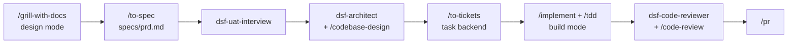

# dsf-matt-pocock workflow

This factory uses [Matt Pocock's skills](https://github.com/mattpocock/skills): small, sharp skills for real engineering. The core idea is that the agent should grill you until the plan is unambiguous, then work in thin tracer-bullet slices, test-first, with deep modules and a shared domain language.

## How a feature flows

1. `make design`, then `/grill-with-docs` with your vision. It asks one hard question at a time, and records terms in `GLOSSARY.md` and decisions as ADRs as they are settled.
2. `/to-spec` turns the conversation into `specs/prd.md`.
3. UAT interview and architecture (`dsf-uat-interview`, `dsf-architect`). `/codebase-design` brings the deep-module vocabulary into the module split.
4. `/to-tickets` breaks the spec into tracer-bullet tickets with blocking edges in the task backend.
5. `make build`, then `/implement` ticket by ticket with `/tdd`.
6. Review with `dsf-code-reviewer`, describe the PR with `/pr`.

The pack's configuration (`docs/agents/`) is written for you by `cloneForApplication.sh` and points at the factory's task backend and ADR folder.

Full step-to-skill mapping: [.dsf/CLAUDE.workflow.md](../../.dsf/CLAUDE.workflow.md).

## Strengths and weaknesses

| Strengths | Weaknesses |
| --- | --- |
| The best requirements interview of the packs (`/grill-with-docs`). | Skills run when you call them; less automatic than Superpowers. |
| Tracer-bullet tickets with explicit blocking edges suit agents well. | No subagent orchestration of its own. |
| Strong architecture vocabulary: deep modules, seams, domain modelling, `/improve-codebase-architecture`. | Assumes GitHub issues by default; the factory maps it to the chosen backend. |

## Installing and upgrading

Claude Code offers to install the plugin the first time it starts in the repo (from `.dsf/settings/workflow.json`). Upgrade with `/plugin` → Marketplaces → update, then run the factory benchmark ([docs/dsf/factory-evolution.md](../dsf/factory-evolution.md#benchmark)).
